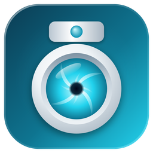

<p align="center"></p>

<h1 align="center">NJ-Flush</h1>

<p align="center">Frees Windows RAM with one double-click, and makes it fun to watch.</p>

<p align="center"></p>

NJ-Flush is a single, self-installing Windows program. Double-click it and it hands memory back to Windows: it empties
every process's working set, writes the modified page list to disk, purges the standby cache and stops leftover helper
processes from closed sessions. While it works, a toilet flushes on your screen. How hard it flushes depends on how
full your RAM was.

| RAM in use | Animation |
|---|---|
| under 80% | **Light flush**: one press, a half drain |
| 80 to 89% | **Medium flush**: the full swirl |
| 90 to 95% | **Heavy flush**: murky water, two presses, the bowl shakes, water splashes |
| 96% and up | **Clogged**: the water rises, the press fails, a plunger goes in three times, then it bursts free |

## Install

1. Download `NJ-Flush.exe` from the [latest release](https://github.com/NJ-Burrito/NJ-Flush/releases/latest).
2. Double-click it. The first time, Windows asks once for admin approval: NJ-Flush copies itself to
   `%LOCALAPPDATA%\NJ-Flush` and registers a scheduled task that runs with the rights a RAM flush needs.
3. From then on every double-click flushes with no prompt.

The program is not code-signed, so Windows SmartScreen may warn on the first run: choose **More info**, then **Run anyway**.

## Use

A small RAM widget sits above the taskbar clock and shows the RAM in use. Its bar takes the colour of the flush it
would play.

| Action | How |
|---|---|
| Flush | double-click the widget, press **Ctrl+Alt+F**, or double-click `NJ-Flush.exe` |
| See where the RAM is | right-click the widget > **Memory breakdown** |
| Last flush, free RAM | hover the widget |
| Watch an animation without flushing | right-click > **Preview animations**, or `NJ-Flush.exe /preview clogged` |
| Remove it | right-click > **Uninstall NJ-Flush...** |

**Settings** (right-click > Settings, saved in `%LOCALAPPDATA%\NJ-Flush\settings.ini`):

| Setting | Default | What it does |
|---|---|---|
| Animation | on | off = flush silently in the background |
| Sound | on | quiet sound effects, at most 10% of full volume |
| Restart File Explorer on flush | on | frees Explorer's memory; turn off to keep open Explorer windows |
| Auto-flush at 90% RAM | off | flushes by itself when RAM stays at 90% or more for 30 seconds, at most once every 10 minutes |
| Start with Windows | off | starts the widget when you sign in |

## What a flush does, and what it cannot do

- Stops leftover helper processes: a `node.exe` / `cmd.exe` tree whose parent is gone, older than 6 hours, whose command line names a known
  developer helper (`npx`, MCP servers, Playwright test servers). Nothing else is ever stopped.
- Restarts File Explorer (optional).
- Calls the Windows memory manager (`NtSetSystemInformation`, `SystemMemoryListInformation`) to empty working sets, flush the
  modified list and purge the standby lists.

Memory held by drivers, the hypervisor, Memory Integrity (VBS/HVCI) or page tables cannot be flushed. **Memory breakdown**
shows how much of that there is.

## Build from source

Windows with .NET Framework 4.x; no SDK, no NuGet.

```
build.cmd                     REM -> dist\NJ-Flush.exe (C# 5, csc.exe from the Framework, WPF + WinForms)
```

| File | Role |
|---|---|
| `NJFlush.cs` | the whole program: installer, flush, overlay animation, widget, settings |
| `build.cmd` | compiles it, embeds the icon and the four sound tracks |
| `make_logo.ps1`, `make_icon.py` | render the logo from vector art, then the `.ico` (Pillow) |
| `make_sfx.py` | mixes `flush-<tier>.wav` from the source recordings on the animation's cue times (needs ffmpeg) |
| `docs/` | the website (GitHub Pages) and the README images |

**Sounds:** real recordings from [Mixkit](https://mixkit.co) under the Mixkit Sound Effects Free License. The mixed
`flush-*.wav` tracks are in the repo; the raw recordings are not (the licence does not allow sharing them on their
own). To re-mix, download Mixkit items 1830, 1871, 1872, 1889, 1311, 1317, 3000 and 1883 into `sfx/` as
`mk-<id>_<name>.wav` and run `python make_sfx.py`.

## Technologies

C# 5 on .NET Framework 4 (WPF for the overlay animation, WinForms for the widget), Win32 / NT native calls, Windows Task
Scheduler, Python + ffmpeg for the sound mix, Pillow for the icon, plain HTML/CSS for the site.

## Licence

MIT, see [LICENSE](LICENSE). Made by Nader Alzghoul.
