<p align="center">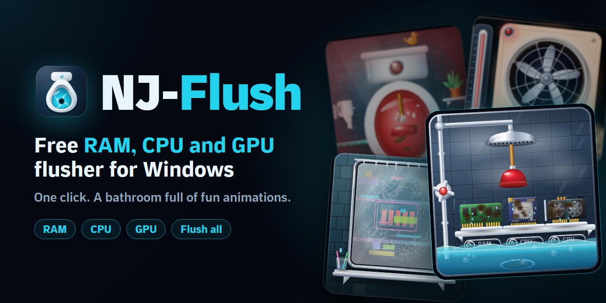</p>

<p align="center"><a href="https://nj-burrito.github.io/NJ-Flush/">Website</a> · <a href="https://github.com/NJ-Burrito/NJ-Flush/releases/latest">Download</a> · <a href="https://nj-burrito.github.io/">More by NJ-Burrito</a></p>

<p align="center">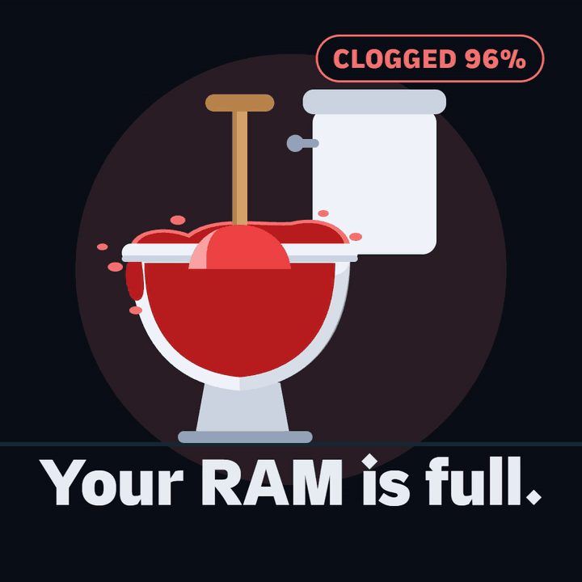</p>

NJ-Flush is a free, open-source Windows tool. It frees RAM, calms busy apps on the CPU and restarts a stuck graphics driver, each with a hotkey or one click. Every flush plays a short animation with its own sound.

It is one `.exe`. No admin prompt after the first run, no service, no driver, no account.

| Flush | What it does | Animation | Shortcut |
|---|---|---|---|
| **RAM** | trims idle background apps, drops the low-priority cache, stops leftover helper processes | a toilet | Ctrl+Alt+R |
| **CPU** | puts apps that kept a CPU core busy for a full minute in efficiency mode (never the app you are using) | an exhaust fan | Ctrl+Alt+C |
| **GPU** | restarts the graphics card (the screen is black for a few seconds) | a mirror | Ctrl+Alt+G |
| **All** | GPU when it helps, then CPU, then RAM | a shower over the three parts | Ctrl+Alt+F |

## Install

1. Download `NJ-Flush.exe` from the [latest release](https://github.com/NJ-Burrito/NJ-Flush/releases/latest).
2. Double-click it. The first time, Windows asks once for admin approval. NJ-Flush copies itself to
   `%LOCALAPPDATA%\NJ-Flush` and registers a scheduled task that runs with the rights a flush needs.
3. From then on, a double-click on `NJ-Flush.exe` opens the panel (or brings it forward and refreshes it). Flushes run with no prompt.

The program is not code-signed, so Windows SmartScreen may warn on the first run. Choose **More info**, then **Run anyway**.

## The four flushes and their variants

Each flush has four variants. The variant depends on how loaded the PC is when you flush, and each has its own sound.

| | Variants (light to heavy) | Chosen by | Preview |
|---|---|---|---|
| 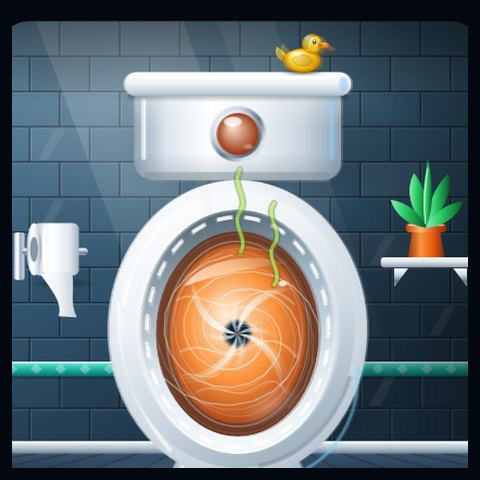 | **RAM**: Light, Medium, Heavy, Clogged | RAM in use: under 80%, 80 to 89%, 90 to 95%, 96% and up | `/preview clogged` |
|  | **CPU**: Breeze, Vent, Overheat, Meltdown | CPU load, or how many apps were busy for a minute (whichever is higher) | `/preview cpu-meltdown` |
| 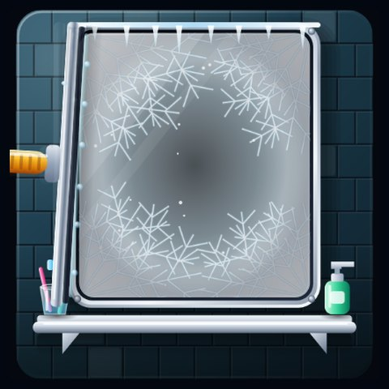 | **GPU**: Smudge, Steamy, Fogged, Frozen | VRAM in use: under 60%, 60 to 84%, 85 to 94%, 95% and up | `/preview gpu-2` |
| 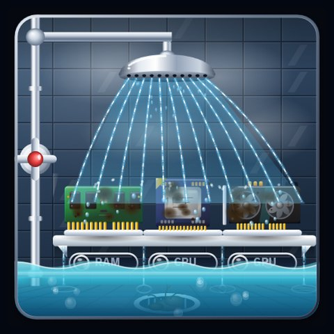 | **All**: Rinse, Shower, Scrub, Flood | the highest of the three; a chip ticks as each part finishes | `/preview all` |

The RAM variants in detail:

| RAM in use | Animation |
|---|---|
| under 80% | **Light flush**: one press, a half drain |
| 80 to 89% | **Medium flush**: the full swirl |
| 90 to 95% | **Heavy flush**: murky water, two presses, the bowl shakes, water splashes |
| 96% and up | **Clogged**: the water rises, the press fails, a plunger goes in three times, then it bursts free |

Below 75% RAM in use (Settings > Flush RAM from) a RAM flush does nothing and says so. The cache it would throw away is free
memory already, and throwing it away makes the next minutes slower.

## The panel

Double-click `NJ-Flush.exe` or the widget, press **Ctrl+Alt+P**, or left-click the tray icon. The panel works like Task Manager: a tile each for RAM, CPU, GPU and the efficiency guard, with a 60-second graph, the top apps (End, and Calm or Restore for CPU) and that page's flush button, which counts down its wait. **Flush all** sits at the bottom.

<p align="center">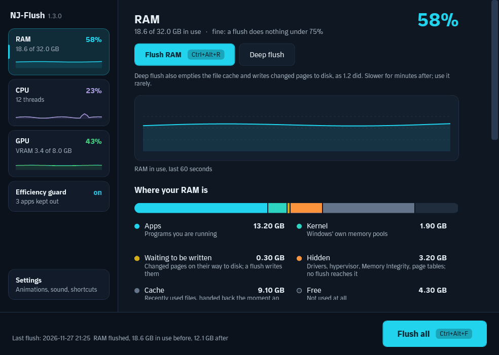 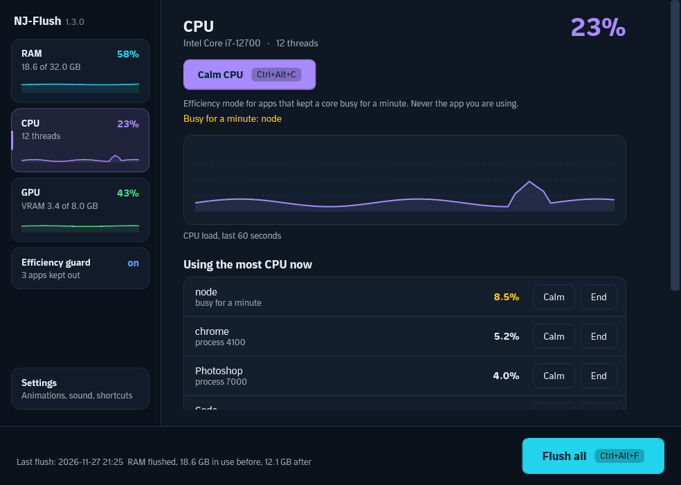</p>
<p align="center">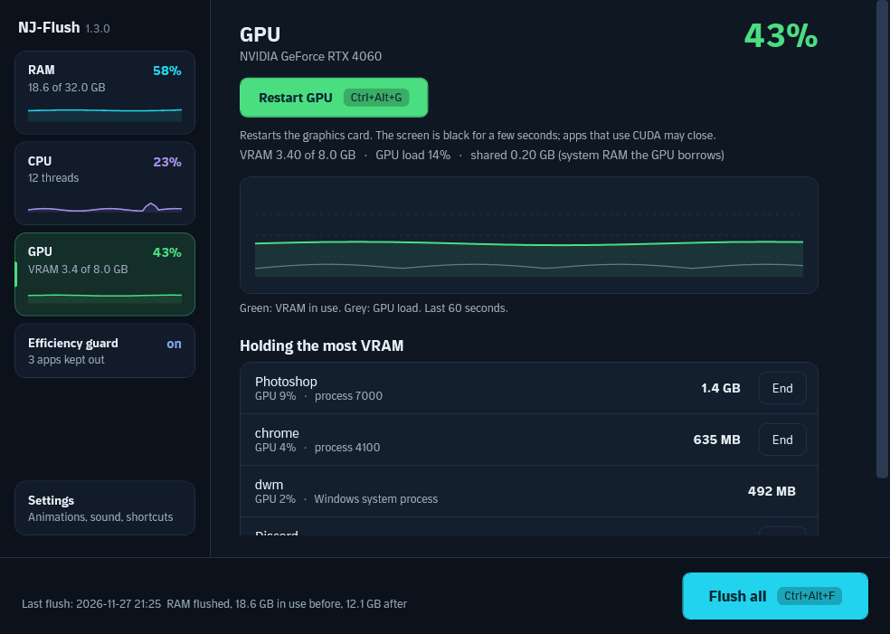 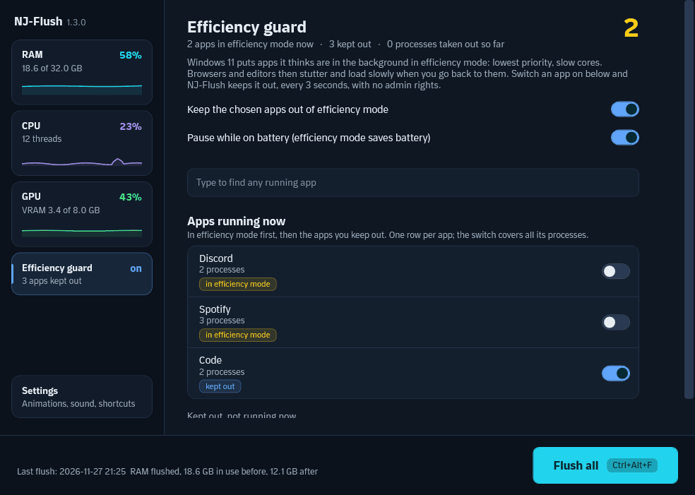</p>

### Efficiency guard

Windows 11 puts background apps in efficiency mode (lowest priority, slow cores). Browsers then stutter and load slowly when you
come back to them. NJ-Flush keeps the apps on its list out of that mode, every 3 seconds, with no admin rights and almost no CPU.
The browsers are on the list by default. The guard page shows what Windows has throttled right now and adds any app with one click.

### Widget and tray icon

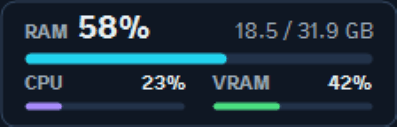

A small widget sits above the taskbar clock. It shows RAM in use with a bar in the colour of the flush it would play, and two
thin bars for CPU and VRAM under it. **Drag it anywhere.** It keeps that spot after restarts and flushes (right-click > Reset
widget position puts it back). Double-click it to open the panel.

NJ-Flush also has an icon in the hidden icons (the ^ next to the clock): left-click opens the panel, right-click shows the menu.

<br clear="right">

### Shortcuts

All four flush shortcuts and the panel shortcut can be changed in Settings. Click a shortcut, press the new keys. The **×**
removes it. A shortcut another app already uses is shown in red.

### Arabic

The panel, the widget and the overlays have an Arabic version with right-to-left layout. Settings > Language / اللغة: Auto follows the Windows display language.

<p align="center">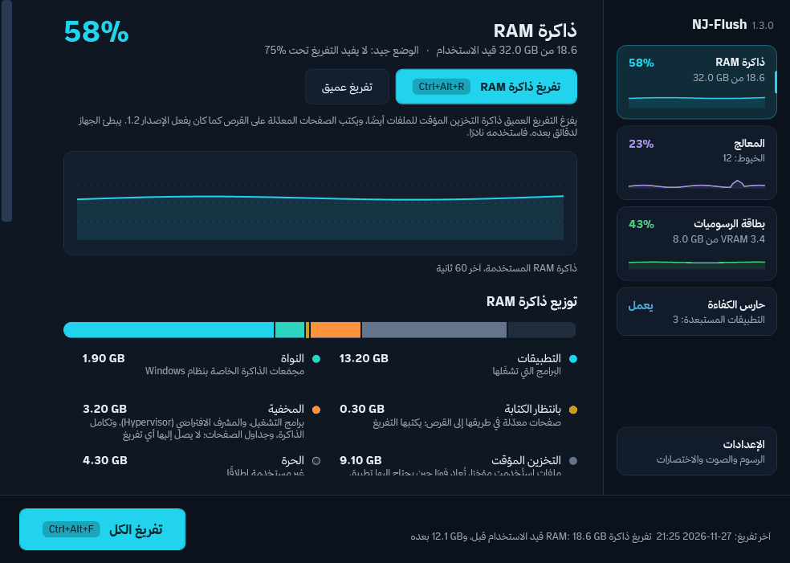 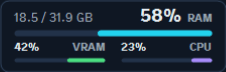</p>

## Use

| Action | How |
|---|---|
| Open the panel | double-click `NJ-Flush.exe` or the widget, left-click the hidden icon, or press **Ctrl+Alt+P**; if it is open, it comes forward and refreshes |
| Flush all | **Flush all** in the panel, or **Ctrl+Alt+F** |
| Flush one | the button on its page in the panel, its shortcut, or right-click > **Flush one** |
| Deep flush | the panel's RAM page: the 1.2 flush (empties every working set, writes changed pages to disk, purges the whole cache); use it rarely |
| Watch an animation without flushing | right-click > **Preview animations**, or Settings > Preview |
| Update | right-click > **Check for updates...**, or Settings > Updates. A newer GitHub release is downloaded, checked against its SHA-256 and swapped in; the widget restarts by itself. |
| Remove it | right-click > **Uninstall NJ-Flush...** |

### Command-line switches

```
NJ-Flush.exe /panel [ram|cpu|gpu|guard]   open the panel on a page
NJ-Flush.exe /settings                    open the Settings page
NJ-Flush.exe /preview clogged             play an animation without flushing (also cpu-meltdown, gpu-2, all)
NJ-Flush.exe /render <variant> <folder>   render one animation off screen to frames and a contact sheet
NJ-Flush.exe /render-ui <page> <folder>   render a panel page or the widget off screen
NJ-Flush.exe /update                      update quietly (exit code 0 updated, 1 already latest, 2 GitHub unreachable, 3 refused)
NJ-Flush.exe /uninstall                   remove the scheduled task
```

An unknown switch does nothing. It never installs or flushes.

## Settings

The panel's Settings page (right-click > **Settings...**, or `NJ-Flush.exe /settings`). Every change is saved at once in
`%LOCALAPPDATA%\NJ-Flush\settings.ini`.

| Setting | Default | What it does |
|---|---|---|
| Language | Auto | Auto, English or Arabic |
| Play the flush animations | on | off = flush quietly in the background |
| Play sound effects | on | the flush sounds, never louder than 10% of full volume |
| Volume | 100% | of that already quiet level |
| Flush RAM from | 75% | below this a RAM flush does nothing |
| Restart File Explorer on flush | **off** (since 1.3) | when on, Explorer is closed gently and comes back; 1.3 turns it off once for everyone who had it from 1.2 |
| Wait between flushes | 60 s | per kind: a flush of the same kind asked for sooner is refused, and the panel counts down |
| Auto-flush RAM when it stays high | off | flushes RAM by itself when it stays at the chosen level (70 to 99%) for 30 s, at most once every 10 minutes; never restarts the GPU |
| Flush all also restarts the GPU when it helps | on | on a Heavy or Clogged RAM flush, or with VRAM 85% full; never on an auto-flush or while a full-screen app is in front |
| Flush all also calms busy apps | on | the CPU flush, as part of Flush all |
| Keep browsers out of efficiency mode | on | the efficiency guard; the apps are chosen on the panel's guard page |
| Pause while on battery | on | efficiency mode saves battery, so the guard rests then |
| Show CPU and VRAM under the RAM bar | on | the widget's two thin bars |
| Brightness when idle | 40% | how visible the widget is when the mouse is not on it |
| Start the widget with Windows | off | starts the widget when you sign in |
| Shortcuts | see the first table | click a shortcut, press the new keys; **×** removes it |
| Check for updates once a day | on | the menu shows «Update to x.y.z...» when a new release is out; nothing installs without you |

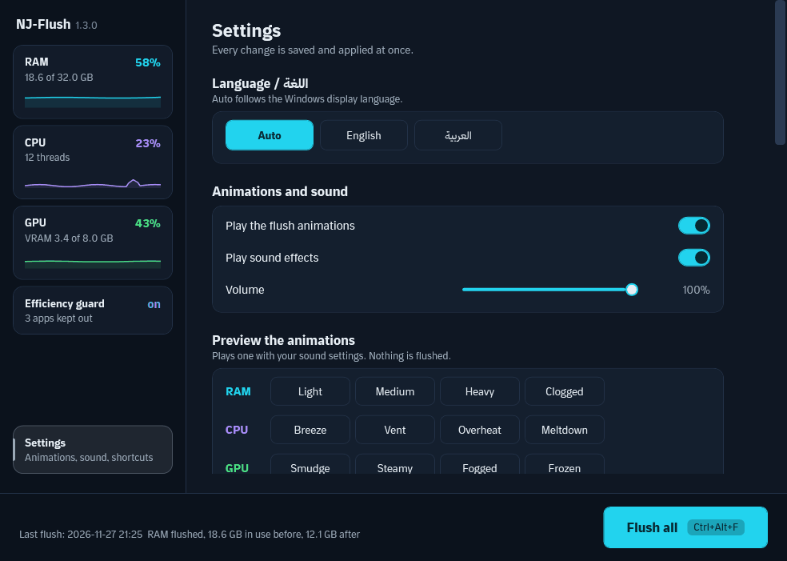

## What a flush does, and what it cannot do

- Stops leftover helper processes: a `node.exe` / `cmd.exe` tree whose parent is gone, older than 6 hours, whose command line names a known
  developer helper (`npx`, MCP servers, Playwright test servers). Nothing else is ever stopped.
- RAM: trims the working set of each idle background app (under 2% of a core, 64 MB or more, never the app in front, Explorer,
  the shell or Windows' own processes), one at a time, then drops the low-priority cache (`SystemMemoryListInformation` command 5).
- CPU: efficiency mode is what Task Manager sets (EcoQoS and Idle priority); **Restore** on the CPU page undoes it.
- GPU: `pnputil /restart-device` on the graphics card with the most dedicated memory. Apps that use the GPU redraw; apps that
  compute on it (CUDA) may fail.
- Every flush is written to `%LOCALAPPDATA%\NJ-Flush\flush.log`: what ran, RAM before and after, and the time.

Memory held by drivers, the hypervisor, Memory Integrity (VBS/HVCI) or page tables cannot be flushed. **Memory breakdown**
shows how much of that there is.

### Why 1.3 flushes RAM gently

A user reported freezes after a RAM flush on a PC with a slow hard disk. The 1.2 flush emptied every working set, wrote the modified
list to disk and purged the whole standby cache at once. Everything it threw away was read back from the disk right after, and
closing Explorer made it worse. 1.3 trims idle apps one at a time, drops only the low-priority cache, does nothing under 75% RAM in
use and leaves Explorer alone. The old flush is still there as **Deep flush**.

Measured on one PC with Opera, VS Code and Claude Code open: 1.2.5 against the 1.3 flush, the 60 seconds after each (full notes in [`design/ab-2026-11-27.md`](design/ab-2026-11-27.md)).

| 60 s after the flush | 1.2.5 | 1.3 |
|---|---|---|
| Page-ins per second, median / peak | 4,130 / 50,623 | 139 / 3,993 |
| Page-ins back to normal | not within 60 s | at once |
| Modified page list, peak | 4,474 MB | 948 MB |
| Hard-disk queue, peak | 5 | 1 |
| Explorer killed | yes | no |

This is a load comparison, not a reproduction of the freeze: the PC did not freeze in either run. The 1.2.5 run followed an
earlier flush that had already emptied part of the cache, so a first flush on a full cache does more than shown. The 1.3 run
had the 75% threshold switched off for the test, at 32% RAM in use.

## Build from source

Windows with .NET Framework 4.x; no SDK, no NuGet.

```
build.cmd                     REM -> dist\NJ-Flush.exe (C# 5, csc.exe from the Framework, WPF + WinForms)
```

| File | Role |
|---|---|
| `NJFlush.cs` | installer, settings, command-line switches, hidden icon, settings window |
| `Work.cs` | one flush job (RAM, CPU, GPU, All) as the elevated task runs it, and its log |
| `Res.cs` | processes, CPU, GPU (DXGI, PDH), efficiency mode, the guard, the sampler, shortcuts |
| `Panel.cs`, `Theme.cs`, `Widget.cs` | the panel, its shared design system, the widget |
| `Strings.cs` | every text in English and Arabic |
| `Scenes.cs`, `SceneToilet.cs`, `SceneFan.cs`, `SceneMirror.cs`, `SceneShower.cs` | the animations, four variants each (beats and sound cues: [`design/1.3-scenes.md`](design/1.3-scenes.md)) |
| `UiRender.cs` | off-screen renders of the panel and widget (`/render-ui`) |
| `make_sfx.py`, `make_sfx_scenes.py` | mix the RAM `flush-<tier>.wav` and the `scene-<kind>-<n>.wav` tracks from Mixkit recordings on the animations' cue times (need ffmpeg) |
| `build.cmd` | compiles it, embeds the icon and the sound tracks |
| `make_logo.ps1`, `make_icon.py` | render the logo from vector art, then the `.ico` (Pillow) |
| `docs/` | the website (GitHub Pages) and the README images |
| `design/` | design notes and the A/B measurement |
| `tests/NJFlush.Tests` | unit tests of the decisions: which leftover processes may be stopped, settings ranges, the cooldown, the flush tier, the updater's checksum rule, the Arabic strings (`dotnet test tests/NJFlush.Tests`, .NET 10 SDK; `NJFlush.csproj` exists only for them) |

**Sounds:** real recordings from [Mixkit](https://mixkit.co) under the Mixkit Sound Effects Free License. The mixed
`flush-*.wav` and `scene-*.wav` tracks are in the repo; the raw recordings are not (the licence does not allow sharing them on their
own). To re-mix the RAM sounds, download Mixkit items 1830, 1871, 1872, 1889, 1311, 1317, 3000 and 1883 into `sfx/` as
`mk-<id>_<name>.wav` and run `python make_sfx.py`.

**Font:** the windows use Thmanyah Sans when it is installed on the PC (it is not bundled: its licence does not allow that); otherwise Segoe UI.

## Technologies

C# 5 on .NET Framework 4 (WPF for the animations and the memory breakdown, WinForms for the widget and settings), Win32 / NT native calls, Windows Task
Scheduler, Python + ffmpeg for the sound mix, Pillow for the icon, plain HTML/CSS for the site.

## Licence

MIT, see [LICENSE](LICENSE). Made by Nader Alzghoul.
